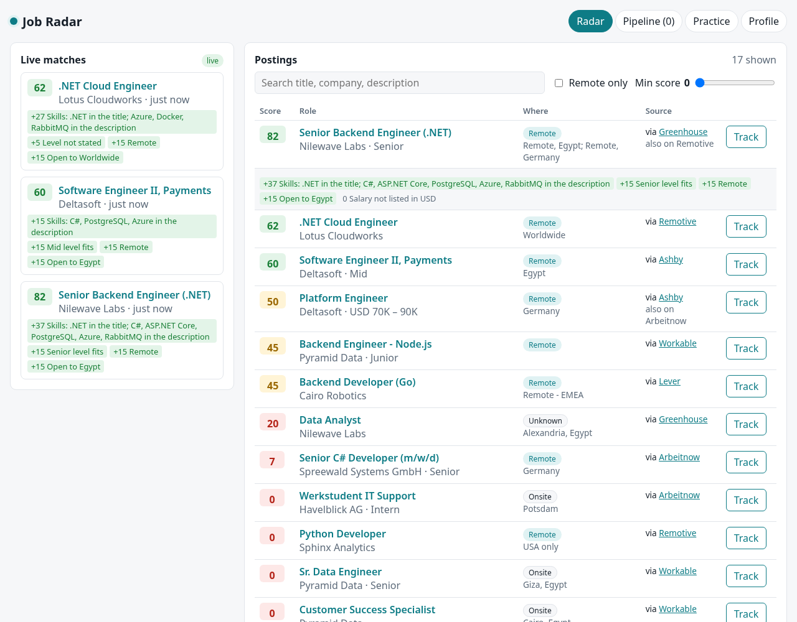
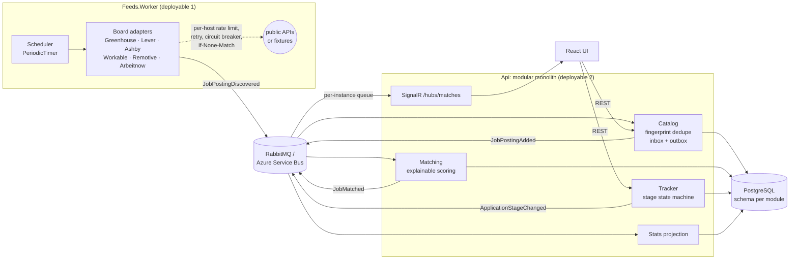

# Job Radar

A self-hosted job radar for engineers. It polls the public job APIs that companies already publish (Greenhouse, Lever, Ashby,
Workable) and two remote-job feeds (Remotive, Arbeitnow), removes duplicates across them, scores every opening against your
profile with reasons you can read, and streams good matches to your browser the moment they are scored. Then it tracks your
applications on a Kanban pipeline with a full history of stage changes.



Built with .NET 10, MassTransit (RabbitMQ or Azure Service Bus), EF Core on PostgreSQL, SignalR, OpenTelemetry and React.



## Quickstart

Needs Docker (or Podman with the Docker CLI). Everything runs offline on invented fixture feeds by default.

```bash
docker compose up -d --build --wait
# UI (live matches, postings, pipeline, practice, profile): http://localhost:8090
# API reference (OpenAPI + Scalar):                         http://localhost:5090/scalar
docker compose down -v
```

Within a few seconds the worker publishes 20 fixture postings; the Catalog keeps 17 (three are mirrored on a second feed) and
the Matching module pushes three matches for the demo profile ("Backend .NET engineer, remote / EMEA"). Edit the profile in the
UI and every posting is rescored; newly qualifying ones arrive in the live feed.

Optional observability: `OTEL_EXPORTER_OTLP_ENDPOINT=http://aspire-dashboard:18889 docker compose --profile obs up -d`, then
open the Aspire dashboard on http://localhost:18888 for traces across the worker, the broker and the API.

### Optional: free-AI "why this matches"

Off by default; the rule reasons are always the answer and the score never comes from a model. To add a two-sentence
plain-language summary when you expand a posting's score, set in `.env` either a free OpenRouter model
(`AI_PROVIDER=OpenRouter`, `AI_MODEL=<id ending in :free>`, `AI_API_KEY=<your key>`; paid model ids fail validation at
startup) or a local Ollama (`AI_PROVIDER=Ollama`, `AI_MODEL=llama3.2`, `AI_BASE_URL=http://host.docker.internal:11434/v1/`).
Summaries are cached until the posting is rescored; any provider error just hides the summary.

### Live feeds

Set `FEEDS_MODE=Live` and list your own boards in `Feeds:Sources` (appsettings or environment), for example:

```json
"Feeds": {
  "Mode": "Live",
  "Sources": [
    { "Kind": "greenhouse", "Board": "<company-board-token>", "Label": "<Company>", "IntervalHours": 24 },
    { "Kind": "remotive", "Board": "software-dev", "Label": "Remotive", "IntervalHours": 12 }
  ]
}
```

The board token is the slug in the company's careers URL (`job-boards.greenhouse.io/<token>`, `jobs.lever.co/<token>`,
`jobs.ashbyhq.com/<token>`, `apply.workable.com/<token>`).

### From source

```bash
dotnet build JobRadar.slnx
dotnet test JobRadar.slnx                 # the integration test needs a Docker-compatible runtime
docker compose up -d --build --wait       # backend on :5090 for the web dev server
cd src/Web && npm ci && npm run dev       # http://localhost:5173, proxies /api and /hubs to localhost:5090
```

## Feeds and their terms

Job Radar reads public, key-less APIs and keeps postings for **your own matching only**. It never republishes them: every
posting links to its original page, the UI credits the feed ("via Greenhouse, also on Remotive"), and you apply on the
employer's site.

| Feed | Endpoint | Terms we follow | Default interval |
|---|---|---|---|
| Greenhouse | `boards-api.greenhouse.io/v1/boards/{board}/jobs?content=true` | Public job board API for embedding a company's openings; link to the posting | 24 h per company |
| Lever | `api.lever.co/v0/postings/{board}?mode=json` | Public postings API; link to the posting | 24 h per company |
| Ashby | `api.ashbyhq.com/posting-api/job-board/{board}` | Public job board API; link to the posting | 24 h per company |
| Workable | `apply.workable.com/api/v1/widget/accounts/{board}` | Public careers widget API; link to the posting | 24 h per company |
| [Remotive](https://remotive.com) | `remotive.com/api/remote-jobs` | No key; a few calls a day at most; credit Remotive and link back; do not republish to other job sites | 12 h |
| [Arbeitnow](https://www.arbeitnow.com) | `www.arbeitnow.com/api/job-board-api` | Public API; link back to each job | 24 h |

The fixtures are invented, but the adapters were also run once against a live response from each public feed
(Greenhouse, Lever, Ashby, Remotive, Arbeitnow) to confirm the shapes; those responses are not stored in this repository.

Politeness is built in, not configured per call (see [ADR 0003](docs/adr/0003-feed-etiquette-and-resilience.md)):
intervals under one hour fail validation, conditional requests (`If-None-Match` / `If-Modified-Since`) turn unchanged feeds
into cheap `304`s, and each host gets its own rate limiter, retry policy and circuit breaker.

## API

| Method | Path | What |
|---|---|---|
| GET | `/api/postings?query=&remote=true&minScore=60` | Deduplicated postings with score and reasons (Catalog + Matching composed) |
| GET | `/api/postings/{id}/explanation` | Rule reasons plus, when `Ai:Provider` is set, a free-model summary (`aiEnabled`, `summary`) |
| GET | `/api/matches?take=50` | Recently announced matches |
| GET / PUT | `/api/profile` | The profile; PUT rescores everything and announces new matches |
| GET / POST | `/api/applications` | The pipeline; POST `{ postingId, note }` starts at Saved |
| POST | `/api/applications/{id}/stage` | `{ stage, note }`; illegal moves answer `409` problem details |
| GET | `/api/stats` | Postings per feed (the second subscriber to `JobPostingAdded`) |
| GET / POST | `/api/applications/{id}/questions` | Interview question bank for an application (seeded with starters at Interview) |
| GET | `/api/questions/due` | Questions due for practice (SM-2 schedule) |
| POST | `/api/questions/{id}/review` | `{ grade: 0..5, notes }` reschedules the card |
| GET | `/api/matches/export` | JSON Resume-flavoured export (`basics`, `skills`) plus matches and their pipeline stage, for other tools |
| GET | `/api/digest?days=7` | Weekly digest: new postings, matches, pipeline moves, questions due |
| WS | `/hubs/matches` | SignalR; server pushes `match` (the `JobMatched` event) |
| GET | `/health/live`, `/health/ready` | Liveness (process) and readiness (Postgres, broker) on both deployables |

## Interview talking points (design notes)

1. **Modular monolith first** ([ADR 0002](docs/adr/0002-modular-monolith.md)). Three bounded contexts (Catalog, Matching,
   Tracker) live in one deployable, each with its own project, `DbContext`, Postgres schema and migrations. They never share
   tables and never reference each other (an architecture test fails the build if they do); they talk through integration
   events, and the host composes the two synchronous reads. Splitting a module out later is a deployment change, not a rewrite.
2. **Pub/sub with real fan-out.** `JobPostingAdded` has two independent subscribers, Matching and a stats projection, each on
   its own queue. Either can be down without the other noticing. `JobMatched` goes to a temporary per-instance queue so every API
   replica hears every match and pushes it to its own SignalR clients (no SignalR backplane needed at this scale).
3. **Transactional outbox + inbox where it matters.** The Catalog consumer saves the posting and publishes `JobPostingAdded`
   through MassTransit's EF Core outbox in one transaction, and the inbox makes a redelivered discovery a no-op. Other consumers
   are idempotent by key (Matching and Stats check the posting id).
4. **Dedupe is a domain rule** ([ADR 0004](docs/adr/0004-dedupe-fingerprint.md)). Exact URLs fail (aggregator pages, tracking
   parameters), so the Catalog fingerprints `norm(company) | norm(title) | place` and falls back to a canonical URL. Every
   normalisation has a unit test with the example that motivated it.
5. **Being a good API citizen** ([ADR 0003](docs/adr/0003-feed-etiquette-and-resilience.md)). `Microsoft.Extensions.Http.Resilience`
   with one pipeline per host: timeout → retry with jitter (honours `Retry-After`) → circuit breaker → token-bucket rate limiter
   → attempt timeout. Conditional GETs, per-feed intervals, exponential backoff for failing feeds, resumable state on disk.
6. **Explainable scoring.** `MatchScorer` is a pure function returning points *with reasons* ("+12 .NET in the title",
   "-25 Limited to USA only"). Each rule has its own test, the UI shows the breakdown, and a profile change rescores locally from
   Matching's own snapshot of each posting.
7. **Domain-enforced state machine.** The Tracker's `JobApplication` aggregate refuses illegal moves (Saved → Offer), records
   every step as a `StageEvent`, and publishes `ApplicationStageChanged`. The API maps refusals to RFC 7807 problem details.
8. **Practice that sticks.** Reaching Interview seeds a question bank for that application; each card is scheduled with
   SM-2 (1 day, 6 days, then interval × ease), so the UI's Practice tab shows only what is due.
9. **One switch for the broker.** `Messaging:Transport=RabbitMq|AzureServiceBus`; consumers and endpoint names are identical,
   only the host line changes. Bicep in `infra/` targets Azure Container Apps + Postgres Flexible Server + Service Bus.
10. **Tests that prove the flow.** Parser tests per board on invented fixtures in each board's real response shape, and one
   Testcontainers test (real Postgres and RabbitMQ) that runs the worker's feed runner, waits for 17 deduplicated postings, receives
   the match over SignalR, drives an application through the pipeline (including a rejected illegal move), practises a
   question and reads the export and the digest.

11. **AI as an optional garnish, not a dependency.** `IMatchExplainer` is an Application port with a disabled default and one
   OpenAI-compatible adapter (OpenRouter `:free` or Ollama). Options validate at startup that only free models are configured;
   failures degrade to "no summary"; nothing about scoring, tests or CI needs a model.

## Project layout

```
src/
  JobRadar.Contracts         integration events (additive changes only)
  JobRadar.ServiceDefaults   OpenTelemetry, health endpoints, transport switch
  JobRadar.Feeds             board adapters, polite HTTP, scheduler, run state
  JobRadar.Feeds.Worker      deployable 1
  JobRadar.Catalog           Domain / Application / Infrastructure (schema "catalog")
  JobRadar.Matching          Domain / Application / Infrastructure (schema "matching") + SignalR hub
  JobRadar.Tracker           Domain / Application / Infrastructure (schema "tracker")
  JobRadar.Api               deployable 2: composition root, endpoints, stats projection
  Web                        React + Vite + TypeScript
tests/
  fixtures/feeds             invented postings per board shape (no real postings)
  JobRadar.UnitTests         parsers, fingerprint, scoring, stage rules, runner, architecture
  JobRadar.IntegrationTests  Testcontainers: Postgres + RabbitMQ + the real API
docs/adr                     architecture decision records
infra                        Bicep (optional, manual deploy; CI only compiles it)
```

## Configuration

See [.env.example](.env.example) for compose overrides. All settings bind to options classes validated at startup
(`Feeds:*`, `Messaging:Transport`, `ConnectionStrings:{jobradar,rabbitmq,servicebus}`, `Cors:Origins`,
`Database:MigrateOnStartup`). Secrets come from the environment only.

## Extracted from Lingo

Job Radar was extracted from Lingo, the author's private personal-assistant app, where it started as a job-leads feature.
This repository is a clean rewrite with fresh history: new architecture, new code, invented fixture data and no personal data.

## License

[MIT](LICENSE)
